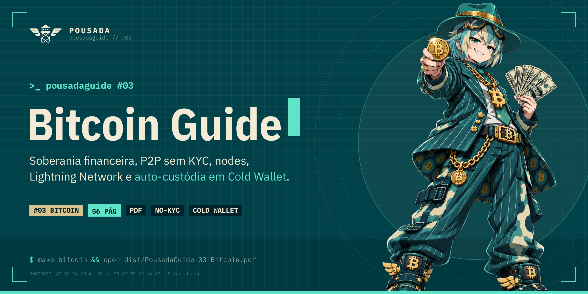

<div align="center">

<a href="https://a-pousada.github.io/PousadaGuides/bitcoin/">
  
</a>

# PousadaGuide #03 — Bitcoin Guide

**Soberania financeira, P2P sem KYC, nodes, mineração caseira, Lightning Network e setups definitivos de Cold Wallet.**<br>
<sub>Inspirado em Bitcoin Optech, Bitcoiner.guide e WalletScrutiny · 56 páginas revisadas pela comunidade</sub>

<br>

[](https://a-pousada.github.io/PousadaGuides/bitcoin/)
[-01424A?style=for-the-badge&labelColor=00222A)](https://github.com/a-pousada/PousadaGuides/releases/latest/download/PousadaGuide-03-Bitcoin.pdf)
[-F3EBD5?style=for-the-badge&labelColor=00222A)](https://github.com/a-pousada/PousadaGuides/releases/latest/download/PousadaGuide-03-Bitcoin-impressao.pdf)
[](../LICENSE)

<br>

[🔙 Voltar para a lista de guias](../README.md) · [🛠️ Instruções de compilação](../README.md#%EF%B8%8F-compilar)

</div>

---

## 📖 Sobre este Guia

O **PousadaGuide #03 — Bitcoin Guide** é o manual completo de soberania financeira, privacidade transacional e auto-custódia em Bitcoin da comunidade Pousada.

- **Por que Bitcoin, não “Cripto” (Shitcoins):** Escassez matemática absoluta (21 milhões), *Proof-of-Work* termodinâmico vs. *Proof-of-Stake*, a Guerra do Tamanho dos Blocos (*Blocksize Wars*) e as 5 Regras de Ouro da Auto-Custódia.
- **DCA, P2P Sem KYC e a Utilidade do Monero (XMR):** Estratégia de acumulação consistente (*Stacking Sats*), os perigos físicos e digitais do KYC em corretoras tradicionais, plataformas P2P descentralizadas (Bisq, RoboSats, Peach) e o uso estratégico do Monero (Feather Wallet, Cake Wallet) como dinheiro anônimo e ponte de quebra de rastreio.
- **Soberania: Seu Próprio Node e Mineração de Loteria:** Como rodar e conectar sua carteira ao seu próprio Full Node (Bitcoin Core, Bitcoin Knots, StartOS, UmbrelOS), consultar taxas sem vazar seu IP (Mempool.space) e minerar blocos solo em casa gastando 15W com o minerador open-source **Bitaxe** e a pool descentralizada **OCEAN (DATUM)**.
- **Lightning Network e Sidechains (Não Confie, Entenda a Utilidade):** Pagamentos instantâneos de auto-custódia na Camada 2 (Phoenix, Zeus) e a verdade técnica sobre Sidechains e Ecash (Liquid Network L-BTC, Cashu, Fedimint): por que nunca usá-las como cofre de longo prazo, mas como dominá-las para acumular aportes de DCA sem gerar micro-UTXOs impagáveis, usando swaps atômicos via **Boltz.exchange**.
- **Carteiras para PC, Celular e Arquitetura Multisig:** Carteiras *Watch-Only*, Sparrow Wallet, Electrum, BlueWallet, Blockstream Green e Nunchuk, além do passo a passo para montar cofres **Multisig (2-de-3)** sem ponto único de falha.
- **Privacidade On-Chain: Controle de UTXOs, Mixers e CoinJoin:** Anatomia dos UTXOs, regras de higiene (*Coin Control*), defesa contra *Dust Attacks*, por que fugir de sites de Mixers custodiais e como funcionam o **JoinMarket**, **PayJoin** e pontes atômicas.
- **Os 4 Melhores Setups de Cold Wallet + Lista Negra:** Passo a passo e comparativo de preço, complexidade e segurança entre **Pendrive + Tails OS + Electrum**, **Celular Antigo Offline + BlueWallet**, **Placa ESP32 + Blockstream Jade DIY / Krux** e **Blockstream Jade Oficial / SeedSigner / Coldcard / BitBox02**, além das carteiras para evitar (Ledger, Atomic, Trust Wallet, Tangem) e blindagem física em **Aço Inox (Arruelas)** com **Passphrase BIP39**.
- **O Mapa do Bitcoiner, Verificação GPG e Checklist:** Auditoria de compilação reproduzível com WalletScrutiny, portais técnicos (Learn Me A Bitcoin, Bitcoin Optech, Bitcoiner.guide, KYCnot.me), verificação GPG no terminal e glossário completo.

## 🗂️ Arquivos da pasta

- `bitcoin.tex`: Código-fonte completo em LaTeX (XeLaTeX).
- `assets/`: Mascote temática da Pousadinha e avatar.
- `Makefile`: Script local para compilação rápida via `make` ou `make print`.

## 🛠️ Como Compilar Localmente

Na raiz do repositório:
```bash
make bitcoin       # Gera Bitcoin/bitcoin.pdf (versão de tela com fundo creme)
make print         # Gera Bitcoin/bitcoin-print.pdf (versão para impressão, fundo branco)
```
