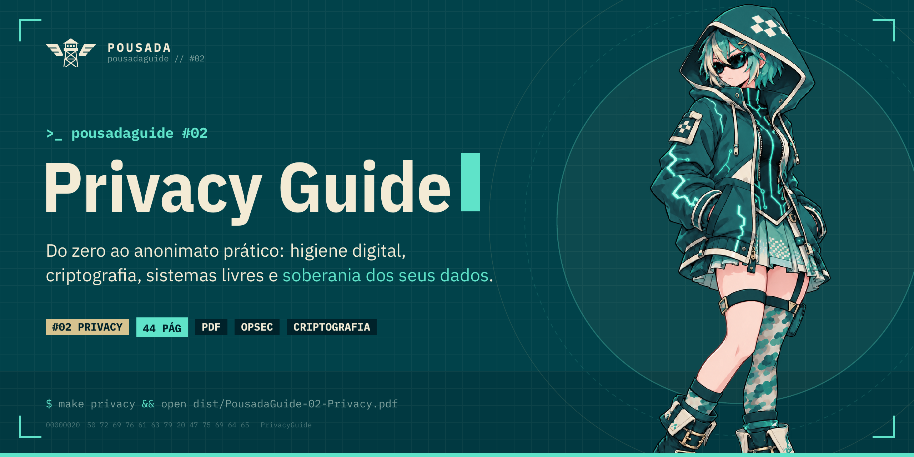

<div align="center">

<a href="https://a-pousada.github.io/PousadaGuides/privacy/">
  
</a>

# PousadaGuide #02 — Privacy Guide

**Do zero ao anonimato prático: higiene digital, criptografia, sistemas livres e soberania dos seus dados.**<br>
<sub>Inspirado em PrivacyGuides.org, Awesome Privacy e EFF SSD · 45 páginas revisadas pela comunidade</sub>

<br>

[](https://a-pousada.github.io/PousadaGuides/privacy/)
[-01424A?style=for-the-badge&labelColor=00222A)](https://github.com/a-pousada/PousadaGuides/releases/latest/download/PousadaGuide-02-Privacy.pdf)
[-F3EBD5?style=for-the-badge&labelColor=00222A)](https://github.com/a-pousada/PousadaGuides/releases/latest/download/PousadaGuide-02-Privacy-impressao.pdf)
[](../LICENSE)

<br>

[🔙 Voltar para a lista de guias](../README.md) · [🛠️ Instruções de compilação](../README.md#%EF%B8%8F-compilar)

</div>

---

## 📖 Sobre este Guia

O **PousadaGuide #02 — Privacy Guide** é o manual definitivo da Pousada sobre soberania digital, privacidade e proteção contra o capitalismo de vigilância contemporâneo.

- **Threat Model Sem Paranoia:** Entenda quem são seus adversários e construa defesas realistas para sua rotina, desmontando o mito do "não tenho nada a esconder".
- **Gestão de Senhas e 2FA Inviolável:** Cofres zero-knowledge com Bitwarden e KeePassXC, abandono definitivo de 2FA via SMS, proteção contra SIM swap, autenticadores livres (Ente Auth, Aegis, 2FAS) e chaves físicas FIDO2/YubiKey.
- **Identidade e Comunicação Segura:** E-mails criptografados ponta a ponta (Proton, Tuta), máscara de endereços via aliases (SimpleLogin, Addy.io), mensageiros privados (SimpleX Chat, Signal, Bitchat, Session) e protocolos abertos e fediverso (Matrix, Fluxer, Nostr, Mastodon).
- **Anti-Fingerprinting e Rastreamento:** Navegação isolada com Mullvad Browser, LibreWolf e Tor Browser, motores de busca neutros (SearXNG, DuckDuckGo, Kagi) e bloqueio sistemático de telemetria.
- **Metadados, Notas e Nuvem Criptografada:** Limpeza de EXIF em fotos, notas com criptografia local (Obsidian, Notesnook) e sincronização segura com Cryptomator, Syncthing e VeraCrypt.
- **Sistemas Operacionais Livres & Blindagem:** Linux com LUKS, compartimentalização extrema com Qubes OS, mitigação no Windows (WinUtil e alerta severo contra ISOs modificadas de terceiros), GrapheneOS no mobile, Obtainium e RethinkDNS.
- **VPNs, VPS e Redes Anônimas:** VPNs Two-Party (Obscura VPN), saltos auditados (Mullvad, Proton VPN, AirVPN com Port Forwarding estático), VPS soberana, protocolos anti-DPI (sing-box com VLESS+REALITY e Hysteria 2), redes descentralizadas (Tor, I2P via `i2pd`) e sistemas amnésicos (Tails OS).
- **Diretórios de Auditoria & Checklist da Pousada:** Referências globais (PrivacyGuides, KYCnot.me, Awesome Privacy, EFF SSD, TOS;DR, HIBP, Exodus), checklist de blindagem gradual e glossário essencial de termos criptográficos.

## 🗂️ Arquivos da pasta

- `privacy.tex`: Código-fonte completo em LaTeX (XeLaTeX).
- `assets/`: Mascote temática cypherpunk da Pousadinha e avatar.
- `Makefile`: Script local para compilação rápida via `make` ou `make print`.

## 🛠️ Como Compilar Localmente

Na raiz do repositório:
```bash
make privacy       # Gera Privacy/privacy.pdf (versão de tela com fundo creme)
make print         # Gera Privacy/privacy-print.pdf (versão para impressão, fundo branco)
```
