<div align="center">

<a href="#-guias">
  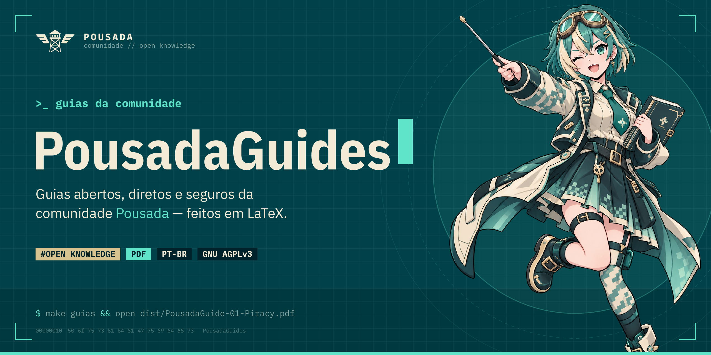
</a>

<br>

[](https://github.com/a-pousada/PousadaGuides/actions/workflows/build.yml)
[](https://github.com/a-pousada/PousadaGuides/releases/latest)
[](LICENSE)
[](pousadaguide.cls)
[](#)

**Guias abertos, diretos e seguros da comunidade Pousada.**<br>
Cada guia é um PDF bonito, organizado e revisado pela comunidade — gerado a partir de código LaTeX aberto.

[**📥 Baixar o último PDF**](https://github.com/a-pousada/PousadaGuides/releases/latest) ·
[Guias](#-guias) ·
[Compilar](#%EF%B8%8F-compilar) ·
[Criar um guia](#-criando-um-novo-guia) ·
[Contribuir](#-contribuindo)

</div>

---

## 📚 Guias

| | Guia | Conteúdo | Download |
|:-:|---|---|:-:|
| <a href="#01--piracy-guide">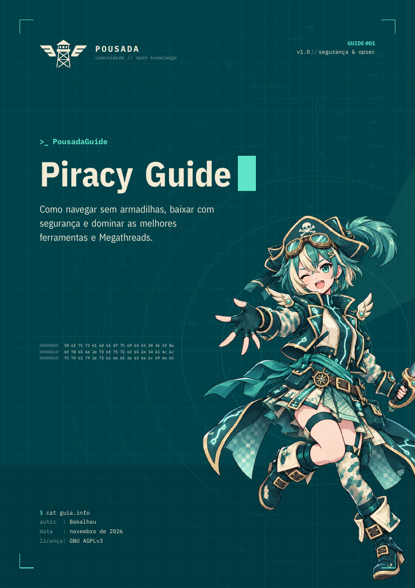</a> | [**#01 — Piracy Guide**](#01--piracy-guide)<br><sub>segurança & opsec · v1.1 · 44 páginas</sub> | Como navegar sem armadilhas, baixar com segurança e dominar as melhores ferramentas e Megathreads. Inspirado na Megathread do `r/Piracy` e no FMHY. | [**Tela**](https://github.com/a-pousada/PousadaGuides/releases/latest/download/PousadaGuide-01-Piracy.pdf)<br>[Impressão](https://github.com/a-pousada/PousadaGuides/releases/latest/download/PousadaGuide-01-Piracy-impressao.pdf) |
| <a href="#02--privacy-guide">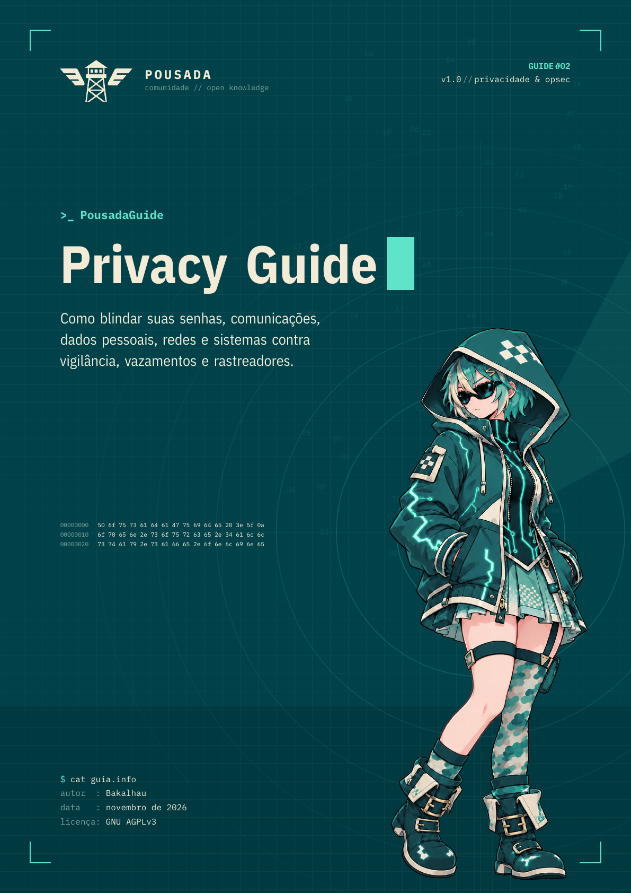</a> | [**#02 — Privacy Guide**](#02--privacy-guide)<br><sub>privacidade & anonimato · v1.0 · 44 páginas</sub> | Do zero ao anonimato prático: higiene digital, criptografia, sistemas livres e soberania dos seus dados. Inspirado em PrivacyGuides e EFF. | [**Tela**](https://github.com/a-pousada/PousadaGuides/releases/latest/download/PousadaGuide-02-Privacy.pdf)<br>[Impressão](https://github.com/a-pousada/PousadaGuides/releases/latest/download/PousadaGuide-02-Privacy-impressao.pdf) |
| <a href="#03--bitcoin-guide">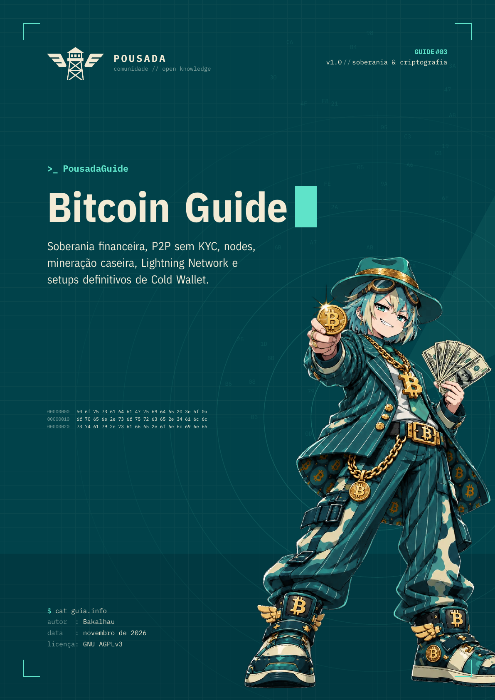</a> | [**#03 — Bitcoin Guide**](#03--bitcoin-guide)<br><sub>soberania & criptografia · v1.0 · 56 páginas</sub> | Soberania financeira, P2P sem KYC, nodes, mineração de loteria, Lightning Network, privacidade de UTXOs e setups definitivos de Cold Wallet. | [**Tela**](https://github.com/a-pousada/PousadaGuides/releases/latest/download/PousadaGuide-03-Bitcoin.pdf)<br>[Impressão](https://github.com/a-pousada/PousadaGuides/releases/latest/download/PousadaGuide-03-Bitcoin-impressao.pdf) |
| — | **#00 — Guia de Exemplo** | Tour por todos os componentes do sistema visual (para quem vai escrever guias). | [PDF](https://github.com/a-pousada/PousadaGuides/releases/latest/download/PousadaGuide-00-Exemplo.pdf) |

> [!TIP]
> A versão de **tela** tem fundo creme (mais confortável para ler). A de **impressão** tem fundo branco e economiza tinta.

### 🏴‍☠️ #01 — Piracy Guide

<a href="https://github.com/a-pousada/PousadaGuides/releases/latest/download/PousadaGuide-01-Piracy.pdf">
  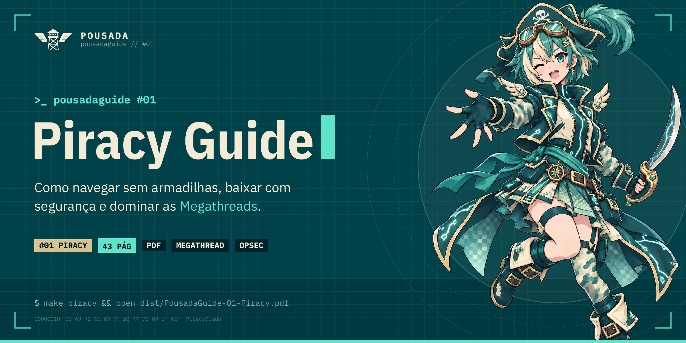
</a>

<p align="center">
  <a href="https://github.com/a-pousada/PousadaGuides/releases/latest/download/PousadaGuide-01-Piracy.pdf"><b>📥 Baixar Guia em PDF (Tela)</b></a> ·
  <a href="https://github.com/a-pousada/PousadaGuides/releases/latest/download/PousadaGuide-01-Piracy-impressao.pdf"><b>🖨️ Versão para Impressão</b></a> ·
  <a href="Piracy/"><b>📁 Ver Pasta do Guia</b></a>
</p>

<table>
<tr>
<td width="33%"></td>
<td width="33%">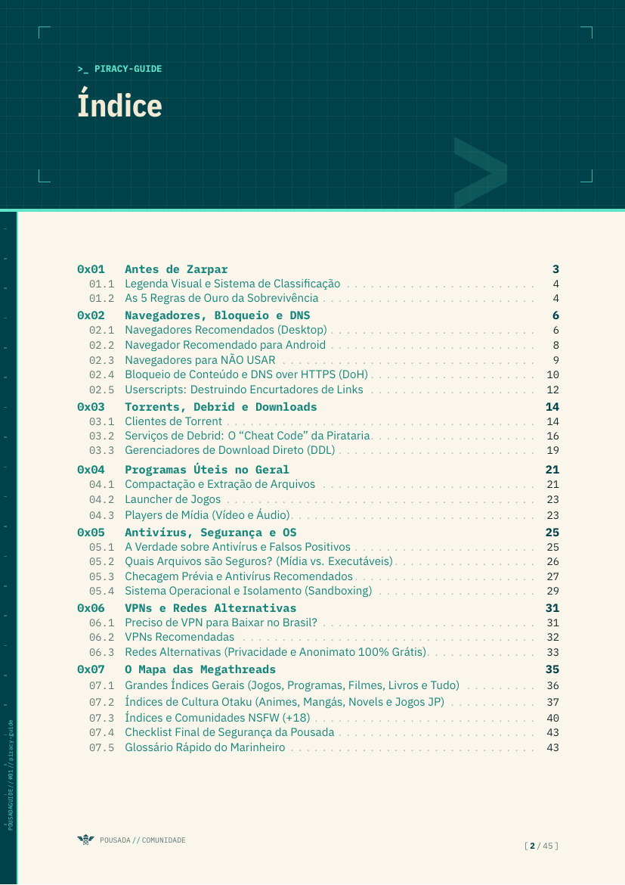</td>
<td width="33%">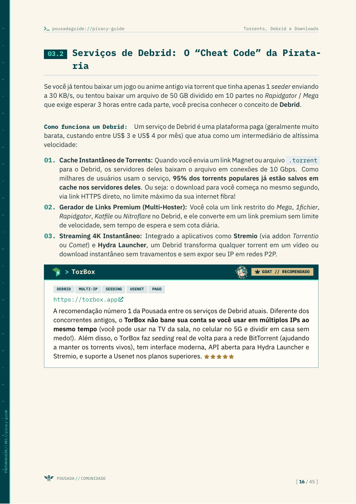</td>
</tr>
</table>

| Capítulo | O que você aprende |
|---|---|
| **01 · Antes de Zarpar** | Legenda do guia, selo **GOAT** da Pousadinha e as 5 Regras de Ouro contra malware |
| **02 · Navegadores, Bloqueio e DNS** | Zen / LibreWolf / Mullvad Browser, uBlock Origin, DNS over HTTPS e Userscripts |
| **03 · Torrents, Debrid e Downloads** | qBittorrent, TorBox / Real-Debrid / AllDebrid, Disbox, JDownloader 2 e Motrix |
| **04 · Programas Úteis no Geral** | 7-Zip / NanaZip, HatchZip, Hydra Launcher, mpv e VLC |
| **05 · Antivírus, Segurança e OS** | Falsos positivos, extensões seguras, VirusTotal, Linux + Bottles e Windows Sandbox |
| **06 · VPNs e Redes Alternativas** | Proton VPN, Mullvad, WireGuard, Tor e I2P — e as VPNs "grátis" a evitar |
| **07 · O Mapa das Megathreads** | FMHY, r/Piracy, Pirataria.link, índices otaku e comunidades NSFW (+18) |

> [!IMPORTANT]
> O guia tem caráter **educativo e de segurança digital**: ensina a evitar malware, golpes e rastreamento. Você é responsável por respeitar as leis do seu país.

### 🛡️ #02 — Privacy Guide

<a href="https://github.com/a-pousada/PousadaGuides/releases/latest/download/PousadaGuide-02-Privacy.pdf">
  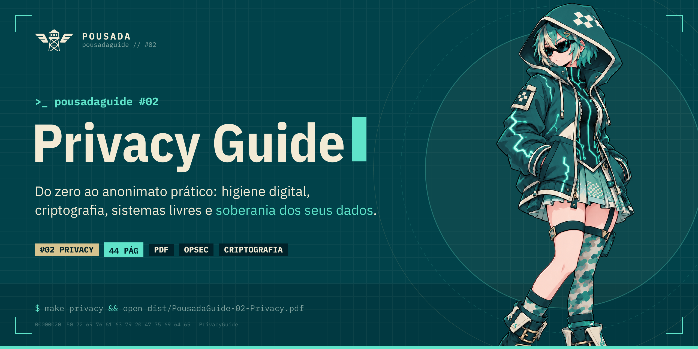
</a>

<p align="center">
  <a href="https://github.com/a-pousada/PousadaGuides/releases/latest/download/PousadaGuide-02-Privacy.pdf"><b>📥 Baixar Guia em PDF (Tela)</b></a> ·
  <a href="https://github.com/a-pousada/PousadaGuides/releases/latest/download/PousadaGuide-02-Privacy-impressao.pdf"><b>🖨️ Versão para Impressão</b></a> ·
  <a href="Privacy/"><b>📁 Ver Pasta do Guia</b></a>
</p>

<table>
<tr>
<td width="33%"></td>
<td width="33%">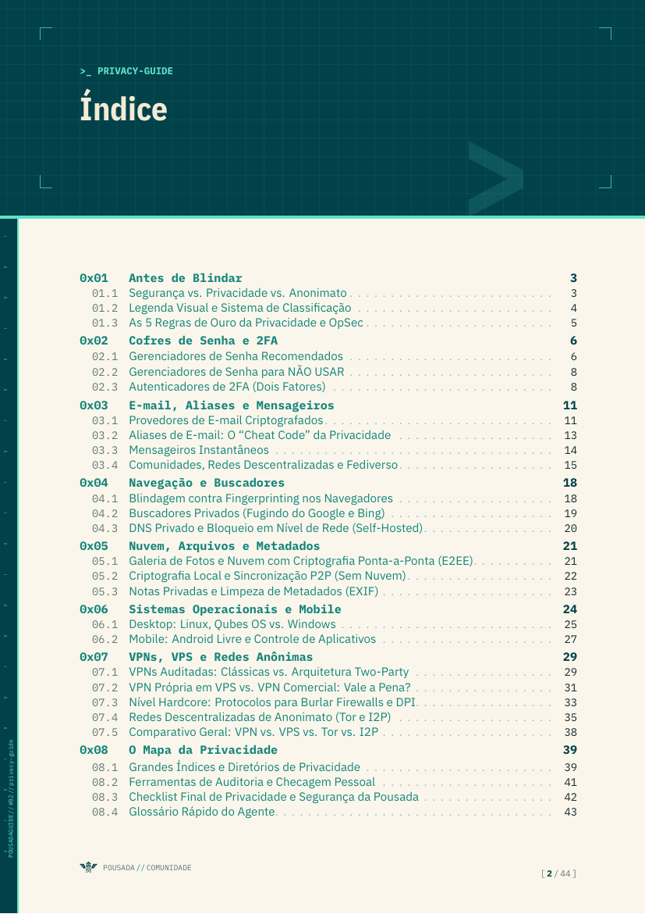</td>
<td width="33%">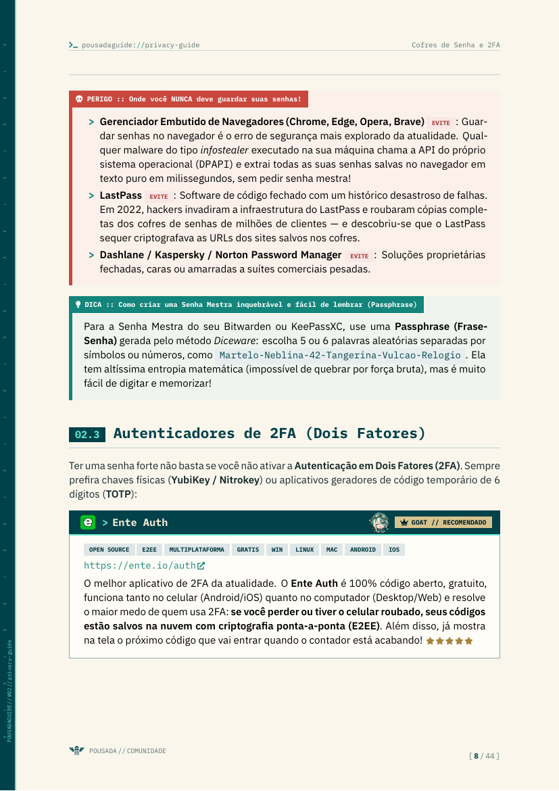</td>
</tr>
</table>

| Capítulo | O que você aprende |
|---|---|
| **01 · Fundamentos & Threat Model** | O mito do "não tenho nada a esconder", modelo de ameaça em 4 perguntas e tabela de adversários |
| **02 · Senhas, Cofres & 2FA** | Bitwarden, KeePassXC, abandono do SMS, SIM swap, Ente Auth, Aegis, 2FAS e chaves de segurança FIDO2/YubiKey |
| **03 · Identidade, E-mail & Mensageiros** | E-mails E2EE (Proton, Tuta), aliases (SimpleLogin, Addy.io), SimpleX Chat, Signal, Bitchat, Session e redes federadas (Matrix, Fluxer, Nostr, Mastodon) |
| **04 · Navegação Anônima & Anti-Fingerprinting** | Browser fingerprinting, Mullvad Browser, LibreWolf, Tor Browser, SearXNG, DuckDuckGo e Kagi |
| **05 · Metadados (EXIF), Notas & Nuvem Soberana** | Limpeza de metadados EXIF, notas seguras (Obsidian, Notesnook) e nuvem criptografada (Cryptomator, Syncthing, VeraCrypt) |
| **06 · Sistemas Operacionais Livres & Blindagem** | Linux com LUKS, compartimentalização com Qubes OS, mitigação no Windows (WinUtil e alerta anti-Ghost Spectre), GrapheneOS, Obtainium e RethinkDNS |
| **07 · VPNs, VPS & Redes Anônimas** | Obscura VPN (Two-Party), Mullvad, Proton VPN, AirVPN (Port Forwarding), VPS soberana, protocolos anti-DPI (sing-box com VLESS+REALITY e Hysteria 2), Tor, I2P e Tails OS |
| **08 · O Mapa da Privacidade, Auditoria & Checklist** | PrivacyGuides, KYCnot.me, Awesome Privacy, EFF SSD, TOS;DR, HIBP, Exodus, checklist em 3 fases e glossário essencial |

### ₿ #03 — Bitcoin Guide

<a href="https://github.com/a-pousada/PousadaGuides/releases/latest/download/PousadaGuide-03-Bitcoin.pdf">
  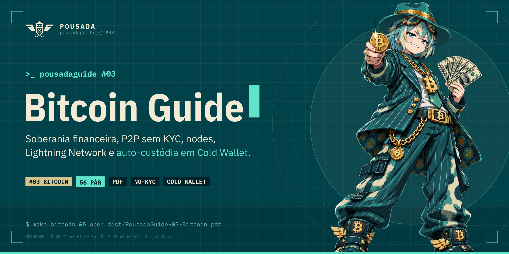
</a>

<p align="center">
  <a href="https://github.com/a-pousada/PousadaGuides/releases/latest/download/PousadaGuide-03-Bitcoin.pdf"><b>📥 Baixar Guia em PDF (Tela)</b></a> ·
  <a href="https://github.com/a-pousada/PousadaGuides/releases/latest/download/PousadaGuide-03-Bitcoin-impressao.pdf"><b>🖨️ Versão para Impressão</b></a> ·
  <a href="Bitcoin/"><b>📁 Ver Pasta do Guia</b></a>
</p>

<table>
<tr>
<td width="33%"></td>
<td width="33%">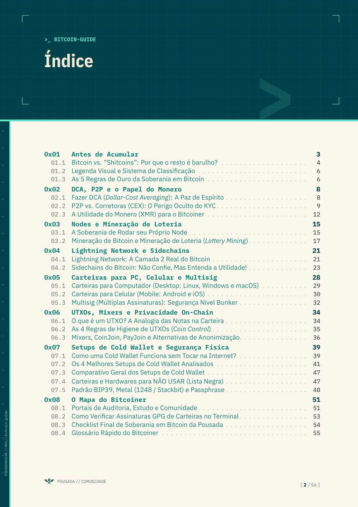</td>
<td width="33%">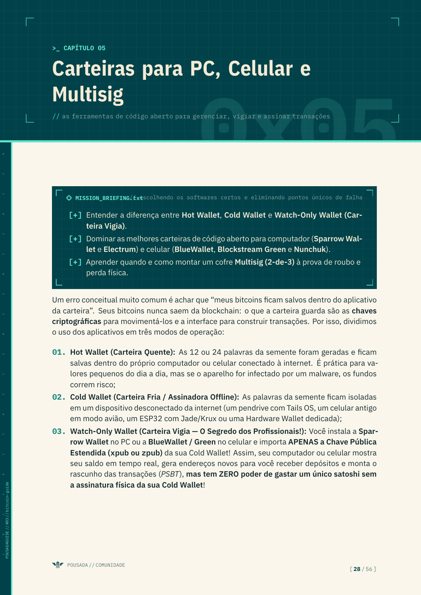</td>
</tr>
</table>

| Capítulo | O que você aprende |
|---|---|
| **01 · Antes de Acumular** | Por que Bitcoin e não "Cripto" (*shitcoins*), *Proof-of-Work* vs. *Proof-of-Stake*, *Blocksize Wars* e as 5 Regras de Ouro da Auto-Custódia |
| **02 · DCA, P2P & o Papel do Monero** | Estratégia DCA (*Stacking Sats*), os perigos físicos do KYC, Bipa para iniciantes, corretoras P2P descentralizadas (Bisq, RoboSats, Peach) e o Monero (XMR) apenas como anonimato rápido/ponte (nunca reserva de valor) |
| **03 · Nodes & Mineração de Loteria** | Rodando seu próprio Full Node (Bitcoin Core / Knots, StartOS, UmbrelOS), Mempool.space via Tor e mineração solo de loteria em casa com **Bitaxe** (15W) e pool **OCEAN (DATUM)** |
| **04 · Lightning Network & Sidechains** | Canais Lightning não-custodiais (Phoenix, Zeus), custodiais para iniciantes (Wallet of Satoshi) e a verdade sobre Sidechains (Liquid L-BTC, Cashu, Fedimint) + swaps via **Boltz.exchange** |
| **05 · Carteiras para PC, Celular & Multisig** | Carteiras *Watch-Only*, Sparrow Wallet, Electrum, BlueWallet, Blockstream Green, Nunchuk e arquitetura **Multisig (2-de-3)** sem ponto único de falha |
| **06 · UTXOs, Mixers & Privacidade On-Chain** | Anatomia dos UTXOs, regras de *Coin Control*, defesa contra *Dust Attacks*, por que fugir de Mixers custodiais e como usar **JoinMarket (CoinJoin)**, **Ashigaru** (sucessor da Samourai), **PayJoin** e pontes atômicas |
| **07 · Setups de Cold Wallet & Segurança Física** | **Pendrive + Tails OS + Electrum**, **Celular Antigo + BlueWallet**, **ESP32 + Jade DIY / Krux** e **Jade Oficial / SeedSigner / Coldcard / BitBox02**, lista negra (Ledger, Atomic, Trust, Tangem), padrão **BIP39** (**Ian Coleman** e **Seedpicker**) e backup em **Aço Inox (Modelo 1248 / Stackbit e Arruelas)** + **Passphrase BIP39** |
| **08 · O Mapa do Bitcoiner** | Comunidade e tutoriais dos **Bitcoinheiros**, WalletScrutiny, Learn Me A Bitcoin, Bitcoin Optech, Bitcoiner.guide, KYCnot.me, verificação GPG no terminal, checklist e glossário |

---

## 🛠️ Compilar

Os PDFs são gerados automaticamente pelo GitHub Actions — você só precisa compilar localmente se for editar.

Precisa de **XeLaTeX** (TeX Live) ou **[Tectonic](https://tectonic-typesetting.github.io)**. pdfLaTeX não funciona (fontes OpenType).

```bash
make              # compila todos os guias
make piracy       # só o Piracy Guide  -> Piracy/piracy.pdf
make print        # versões de impressão (fundo branco)
make dist         # PDFs finais em dist/ (igual à Release)
make banner       # regenera o banner do README
make previews     # regenera as prévias de página do README
make clean
```

<details>
<summary><b>NixOS / sem instalar nada</b></summary>

```bash
nix shell nixpkgs#tectonic nixpkgs#poppler-utils -c make dist ENGINE=tectonic
```

</details>

Fontes: **IBM Plex Sans / Sans Condensed / Mono** (pacote `plex-otf`, já incluso no TeX Live e no Tectonic).

### 🚀 Publicando uma versão

```bash
git tag v1.0.0
git push origin v1.0.0
```

O workflow [`build.yml`](.github/workflows/build.yml) compila tudo e cria uma **Release** com os PDFs anexados. Em todo push/PR os PDFs também ficam disponíveis como *artefato* na aba **Actions**.

---

## 🗂️ Estrutura

```
PousadaGuides/
├── pousadaguide.cls        # a classe LaTeX: todo o sistema visual
├── exemplo.tex             # #00 — guia de exemplo com todos os componentes
├── Piracy/                 # #01 — Piracy Guide
│   ├── piracy.tex
│   ├── base.txt            #   anotações/rascunho original do guia
│   └── assets/             #   capa e avatar específicos deste guia
├── Privacy/                # #02 — Privacy Guide
│   ├── privacy.tex
│   └── assets/             #   capa e avatar temáticos cypherpunk
├── Bitcoin/                # #03 — Bitcoin Guide
│   ├── bitcoin.tex
│   └── assets/             #   capa e avatar temáticos soberanos
├── assets/                 # recursos compartilhados entre guias
│   ├── logo-*.png          #   logo Pousada (creme/teal)
│   ├── pousadinha*.png     #   mascote padrão + avatar
│   ├── goat.png            #   selo GOAT
│   └── logos/              #   logos dos serviços (128×128, padronizados)
├── art/                    # artes originais em alta e fontes dos logos (SVG/PNG)
├── docs/                   # banners e prévias para o README
│   ├── banner.png          #   banner geral do projeto (clicável -> lista de guias)
│   ├── banner-piracy.png   #   banner temático #01 (clicável -> download do PDF)
│   ├── banner-privacy.png  #   banner temático #02 (clicável -> download do PDF)
│   ├── banner-bitcoin.png  #   banner temático #03 (clicável -> download do PDF)
│   ├── social-preview.png  #   card para compartilhamento em redes (1280×640)
│   ├── banner/             #   fontes TikZ dos banners
│   └── previews/           #   prévias das páginas para o README
└── .github/workflows/      # build + release automáticos
```

---

## ✍️ Criando um novo guia

> [!TIP]
> **Manual completo para pessoas e agentes de IA:** Consulte o [**AGENTS.md**](AGENTS.md) para o tutorial completo e detalhado de como criar novos temas do zero, padronizar logos, gerar banners temáticos e utilizar todos os componentes da classe [`pousadaguide.cls`](pousadaguide.cls).

1. Crie uma pasta (ex.: `Linux/`) com um link para a classe: `ln -s ../pousadaguide.cls Linux/`
2. Coloque a capa/avatar do guia em `Linux/assets/` (os recursos de `assets/` já são encontrados automaticamente).
3. Escreva o `.tex`:

```latex
\documentclass{pousadaguide}        % [print] para versão de impressão
\guiamascote{linux-capa}            % opcional: mascote da capa
\guiaavatar{linux-avatar}           % opcional: avatar da Pousadinha
\guianumero{02}
\guiatitulo{Linux Guide}
\guiasubtitulo{Do zero ao terminal sem medo.}
\guiaslug{linux-guide}
\guiacategoria{sistemas}
\guiaversao{v1.0}
\guiaautor{Bakalhau}
\guiadata{dezembro de 2026}
\guialicenca{GNU AGPLv3}
\begin{document}
\capa
\tableofcontents
\comentario{subtítulo do capítulo}
\chapter{Introdução}
...
\contracapa
\end{document}
```

4. Adicione os alvos no [`Makefile`](Makefile) (`compile` e `dist`) e uma linha na tabela de guias acima.
5. Crie o banner temático do guia copiando `docs/banner/banner-piracy.tex` para `docs/banner/banner-<tema>.tex` com a mascote do tema e inclua no `make banner`.

### Componentes

| Componente | Uso |
|---|---|
| Ficha de ferramenta | `\begin{ferramenta}[goat,logo=qbittorrent]{Nome}{https://url}{tag1, tag2}…\end{ferramenta}` |
| ↳ selos | `goat`, `recomendado`, `evite` — e `logo=`/`logo2=` com o nome do arquivo em `assets/logos/` |
| Missão (objetivos) | `\begin{missao}[legenda] \begin{itemize}…\end{itemize} \end{missao}` |
| Callouts | `nota`, `dica`, `atencao`, `perigo`, `legenda` — `\begin{dica}[título]…\end{dica}` |
| Resumo | `\begin{tldr}…\end{tldr}` |
| Mascote fala | `\begin{pousadinha}[rótulo]…\end{pousadinha}` |
| Terminal | `\begin{terminal}[título da janela]` … `\end{terminal}` |
| Código | `\begin{codigo}[language=JavaScript]{arquivo.js}` … `\end{codigo}` |
| Passo a passo | `\begin{passo}{Título}…\end{passo}` |
| Tabela | `\begin{tabela}{l X c} \cab{A} & \cab{B} & \cab{C} \\ … \end{tabela}` |
| Checklist | `\begin{checklist} \feito … \item … \opcional … \end{checklist}` |
| Em linha | `\cmd{código}`, `\kbd{Ctrl}`, `\pgtag{open source}`, `\pglink[texto]{url}`, `\pglogo{mpv}` |
| Marcadores | `\goat`, `\ok`, `\nope`, `\meio`, `\estrelas{4}`, `\divisor` |

> [!NOTE]
> `\cmd{}` lê o argumento literalmente — não use dentro de argumentos de outros comandos (ex.: títulos). Em URLs, escape `#` e `%` como `\#` e `\%`.

<details>
<summary><b>🎨 Paleta</b></summary>

| Nome | Hex | Papel |
|---|---|---|
| `pgTeal` | `#01424A` | primária (logo) |
| `pgCream` | `#F3EBD5` | contraste (logo) |
| `pgAbyss` / `pgVoid` | `#01323A` / `#00222A` | terminais e blocos escuros |
| `pgGlow` | `#5FE3C9` | acento sobre fundo escuro |
| `pgSignal` | `#14857A` | acento/links sobre fundo claro |
| `pgKhaki` / `pgBrass` | `#D6C38F` / `#A8823F` | acentos quentes (Pousadinha, destaque) |
| `pgAmber` / `pgAlert` | `#D9962B` / `#C9483E` | atenção / perigo |
| `pgInk` / `pgMuted` | `#14292C` / `#5F7774` | texto |
| `pgPaper` | `#FAF6EC` | fundo da página |

</details>

<details>
<summary><b>🖼️ Logos dos serviços</b></summary>

Os logos ficam em `assets/logos/` como PNG **128×128** transparente, com o desenho recortado e centralizado em 112 px — assim todos aparecem com o mesmo tamanho nas fichas. As fontes originais (SVG/PNG) ficam em `art/logos-src/`. Para adicionar um novo, converta para esse padrão e use `logo=<nome>` na ficha.

</details>

---

## 🤝 Contribuindo

- **Link quebrado, suspeito ou sugestão?** Abra uma [issue de link](https://github.com/a-pousada/PousadaGuides/issues/new?template=link.yml).
- **Quer editar o texto?** Faça um fork, edite o `.tex` e abra um Pull Request — o CI compila o PDF e deixa como artefato para revisão.
- Novos guias são muito bem-vindos! Siga a seção [Criando um novo guia](#-criando-um-novo-guia).

## 📄 Licença

Conteúdo e código sob a licença **[GNU Affero General Public License v3.0 (AGPL-3.0)](LICENSE)**.

<sub>Logos e marcas citados pertencem aos seus respectivos donos e são usados apenas para identificação. Mascote Pousadinha e logo Pousada © Comunidade Pousada.</sub>

<div align="center">
<br>

<br>
<sub><code>POUSADA // COMUNIDADE</code></sub>
</div>
